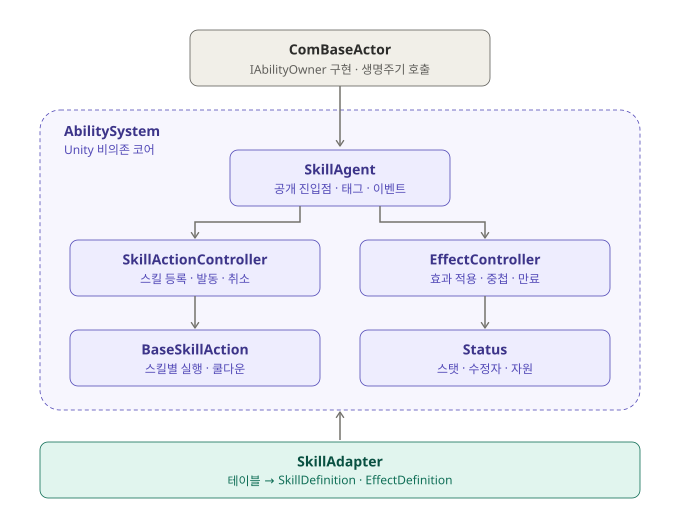
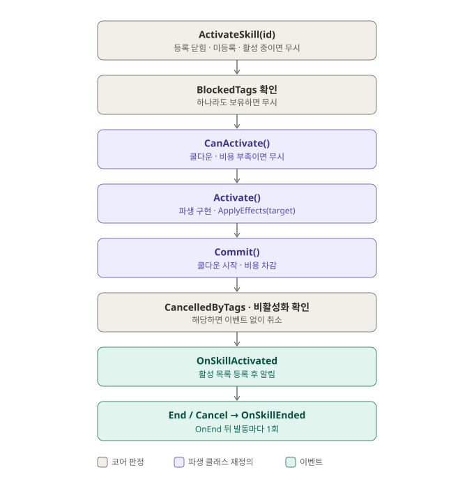
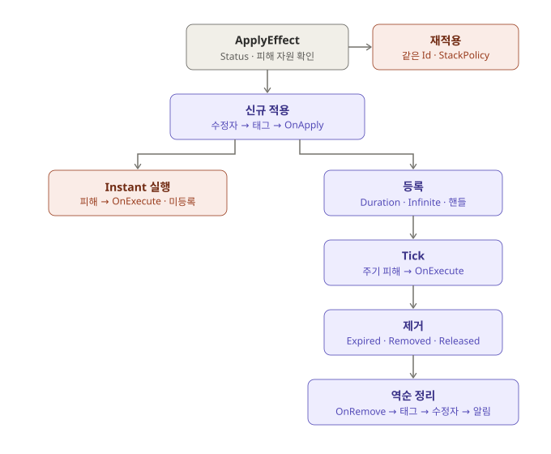
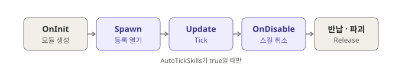

# 능력 시스템

능력 시스템은 Actor 하나에 스킬 발동, 지속 효과, 태그, 스탯·자원을 붙이는 Unity 비의존 C# 코어다. 게임 코드는 `ComBaseActor`에서 `AddSkillAgent()`·`AddStatus()`를 호출하고 스킬 등록, 발동, 효과 적용만 한다. 생성 뒤의 열기, 틱, 취소, 정리는 `ComBaseActor` 생명주기가 맡는다.

## 범위

- 코어(`Client/Assets/Script/AbilitySystem/`)는 스킬, 효과, 태그, 스탯·자원 규칙만 가진다.
- 데미지 공식, 대상 탐색, 타격 판정, 피아 구분, 사망 처리는 게임 콘텐츠라 범위 밖이다. 코어는 교체 지점(`DamageExecution`, `BaseSkillAction` 파생, `EffectBehavior` 파생)만 둔다.
- 코어에는 asmdef가 없다. 코어, 어댑터, 호스트가 모두 Assembly-CSharp에 컴파일된다. 코어가 `UnityEngine`, `Global`, `DesignTable`, `ComBaseActor`를 참조하지 않는다는 규칙은 컴파일러가 아니라 코드 리뷰로 유지한다.

## 설계 원칙

| 기준 | 내용 |
| --- | --- |
| C1 콘텐츠 독립 | 코어에 특정 게임의 종류, 수치, 규칙이 없다. 게임은 데이터와 확장 클래스로 채운다. 스턴도 코어 규칙이 아니라 어댑터가 정한 태그 데이터다. |
| C2 수정 없는 확장 | 새 효과, 태그, 스탯을 추가할 때 코어 코드를 고치지 않는다. 태그와 스탯은 이름 등록, 효과와 스킬은 정의 데이터와 팩토리로 늘린다. |
| C3 의존 방향 | 코어는 프로젝트 전용 타입(`Global`, `DesignTable`, `ComBaseActor`)을 모른다. 소유자는 `IAbilityOwner`로만 본다. 테이블 해석은 어댑터 한 곳에서 한다. |
| C4 정의와 실행 상태 분리 | 불변 정의(`SkillDefinition`, `EffectDefinition`)와 실행 중 상태(`BaseSkillAction`·`SkillSpec`, 활성 효과)를 나눈다. 적용 시점 값은 지금 시전자뿐이고, 레벨·수치 덮어쓰기(EffectSpec)는 보류다. |
| C5 관찰 가능성 | 게임이 반응할 이벤트(스킬 발동·종료, 효과 적용·제거, 태그 변화, 스탯·자원 변화)를 제공한다. |

## 구조



```
Client/Assets/Script/
├─ AbilitySystem/                       코어 (asmdef 없음)
│  ├─ Skill/
│  │  ├─ SkillAgent.cs                  공개 진입점, 태그 카운트, 이벤트, EnterCallInternal
│  │  ├─ SkillDefinition.cs             스킬 정의, SkillCost
│  │  ├─ EffectDefinition.cs            효과 정의, 지속·중첩 정책, EffectModifier
│  │  ├─ SkillTag.cs                    이름 등록형 태그
│  │  ├─ IAbilityOwner.cs               소유자 계약 (SkillAgent, Status, SpawnSerial)
│  │  ├─ DamageExecution.cs             교체 가능한 피해 공식, FlatDamageExecution
│  │  ├─ Action/
│  │  │  ├─ BaseSkillAction.cs          스킬 실행 기반 클래스, SkillSpec, SkillEndReason
│  │  │  └─ SkillActionController.cs    (internal) 등록, 발동, 취소, 활성 목록
│  │  └─ Effect/
│  │     ├─ EffectBehavior.cs           효과 특수 동작 확장, EffectRemoveReason
│  │     └─ EffectController.cs         (internal) 적용, 중첩, 틱, 만료, 정리, EffectHandle
│  └─ Stat/
│     ├─ Status.cs                      스탯, 수정자, 자원, StatModOp
│     ├─ StatId.cs                      이름 등록형 스탯 id
│     └─ NameRegistry.cs                (internal) SkillTag·StatId 공용 등록 규칙
├─ SkillAdapter/
│  ├─ SkillDefinitions.cs               테이블 → 정의 변환과 캐시, 게임 태그·스탯 등록
│  └─ Action_Normal/Melee/Range.cs      skill_type별 실행 클래스 (Activate에서 바로 End)
└─ Actor/ComBaseActor.cs                IAbilityOwner 구현, 생명주기 연동
```

| 클래스 | 책임 |
| --- | --- |
| `SkillAgent` | Actor당 하나. 스킬 부여·발동·취소, 효과 적용·제거, 태그 조회, 태그 부여 횟수, 이벤트, 등록 열림·닫힘 |
| `SkillActionController` | 부여된 스킬과 활성 스킬 목록, 매 틱 갱신, 태그·비활성화에 의한 일괄 취소 |
| `BaseSkillAction` | 발동 수명(`CanActivate` → `Activate` → `Commit` → `End`·`Cancel`), 쿨다운, 비용, `ApplyEffects` |
| `EffectController` | 활성 효과 목록, 시간 진행(주기·만료), 중첩 정책, 수정자·태그·피해의 적용과 되돌림, 핸들 |
| `Status` | 스탯 기본값·현재값, 수정자 집계, 자원, 변경 이벤트. `SkillAgent`가 없는 Actor도 가질 수 있다. |

## 스킬 발동과 종료



### SkillAgent 스킬 API

| API | 동작 |
| --- | --- |
| `GiveSkill(SkillDefinition)` | `ActionFactory`로 실행 인스턴스를 만들어 등록한다. 등록이 닫혀 있거나, 같은 Id가 이미 있거나, 팩토리가 이미 등록된 인스턴스를 돌려주면 예외다. |
| `ActivateSkill(int)` | 발동을 요청한다. 아래 조건 중 하나면 아무것도 하지 않는다. |
| `CancelSkill(int)` | 활성 스킬을 취소한다. 미등록이거나 활성이 아니면 무시한다. |

`ActivateSkill`은 다음 경우에 조용히 무시된다. 쿨다운·비용·이벤트도 없다.

- 등록이 닫혀 있다(스폰 전, 정리 중, 정리 뒤).
- 스킬이 등록되어 있지 않다.
- 스킬 상태가 `Idle`이 아니다. 발동 처리 중(`Activating`), 활성(`Active`), 종료 처리 중(`Ending`)이 모두 해당한다.
- `BlockedTags` 중 하나를 가지고 있다.
- `CanActivate()`가 false다. 기본 구현은 쿨다운 중이거나 비용 자원이 하나라도 부족하면 false다.

비용이 있는 스킬을 `Status` 없는 Actor에서 발동하면 예외다. 정의되지 않은 비용 자원은 `GetResource`가 예외로 드러낸다.

### 발동 순서

1. `CanActivate()`보다 먼저 `SkillAgent`의 비활성화 횟수(`deactivationCount`)를 기록한다. `CanActivate`의 부작용으로 일어난 비활성화도 잡기 위해서다.
2. 상태를 `Activating`으로 바꾸고 `Activate()`를 호출한다.
3. `Commit()`이 쿨다운을 `CoolTime × (1 − min(감소율, 1))`로 시작하고 비용을 차감한다. 감소율은 `CooldownReductionStat`의 값이고, 이 스탯이 `default`이거나 `Status`가 없으면 0이다.
4. 아직 `Activating`인데 발동 중 비활성화되었거나(기록한 횟수와 다름) `CancelledByTags` 중 하나를 가지고 있으면 `Cancel()`하고 `Idle`로 돌린다. 이 발동은 발동·종료 이벤트를 모두 내지 않는다. 쿨다운과 비용은 이미 소모되었다.
5. 스킬이 아직 활성이면 활성 목록에 넣는다.
6. `OnSkillActivated`를 알린다. 목록에 넣은 뒤 알리므로, 핸들러가 얻은 취소 태그가 이 스킬을 취소한다.

`Activate()` 안에서 `End()`·`Cancel()`한 스킬은 `Ending` 상태로 종료 알림을 미뤘다가 발동 알림 뒤에 `OnSkillEnded`를 낸다.

### 종료 계약

- `End()`는 `SkillEndReason.Completed`, `Cancel()`은 `SkillEndReason.Cancelled`로 끝낸다. 태그 취소, `CancelSkill`, 비활성화 취소, 정리 중 취소는 모두 `Cancelled`다.
- `End()`와 `Cancel()`은 재정의할 수 없다. 확장은 `protected virtual void OnEnd(SkillEndReason reason)`로 받고, 활성 스킬이 끝날 때 한 번만 불린다. 하위 클래스가 base 호출을 빠뜨려 스킬이 영구 활성으로 남는 실수를 막기 위해서다.
- 이미 끝난 스킬에 `End()`·`Cancel()`을 다시 호출하면 무시한다. 종료 알림은 한 번만 나간다.
- 발동·종료 알림은 알린 발동마다 한 쌍이고, 종료는 항상 발동 뒤에 나간다.
- `OnEnd` 실행 중과 미룬 종료 알림 전에는 상태가 `Ending`이라 같은 스킬을 다시 발동할 수 없다. 이때 재발동하면 새 발동 알림이 이전 종료 알림보다 먼저 나가기 때문이다. 재발동과 연계는 `OnSkillEnded` 핸들러에서 한다.

### 확장 지점

| 멤버 | 용도 |
| --- | --- |
| `Activate()` (필수) | 실제 동작. 즉시형은 여기서 `End()`를 호출한다. |
| `CanActivate()` | 발동 조건 추가. 기본은 쿨다운과 비용 확인이다. |
| `Commit()` | 쿨다운·비용 처리 변경 |
| `OnUpdate(float)` | 활성 중 매 틱 |
| `OnEnd(SkillEndReason)` | 종료 시 한 번 |
| `ApplyEffects(SkillAgent target)` | 정의의 `Effects`를 대상에 시전자 = 소유자로 건다. 대상 선택은 실행 클래스가 하고, 자신에게 걸 때는 `Owner.SkillAgent`를 넘긴다. |
| `Spec` | `Definition`, `CoolDownRemaining`, `IsOnCoolDown` |

예시는 `Client/Assets/Script/Sample/TurnBattle/TurnBattleDefinitions.cs`의 `TargetedAction`(즉시형)과 `MeditateAction`(여러 틱 유지)이다.

### SkillDefinition 필드

| 필드 | 동작 |
| --- | --- |
| `Id`, `CoolTime` | 쿨다운은 `Commit`에서 시작한다. |
| `ActionFactory` | `GiveSkill`마다 호출된다. 소유자마다 실행 상태를 따로 가지므로 매번 새 인스턴스를 돌려줘야 한다. |
| `BlockedTags` | 하나라도 가지면 발동하지 않는다. |
| `CancelledByTags` | 활성 중 하나를 새로 얻거나, 발동 직후 가지고 있으면 취소된다. |
| `CooldownReductionStat` | 쿨다운 감소율로 읽을 스탯. `default`면 감소하지 않는다. |
| `Effects` | `ApplyEffects`로 걸 효과 목록 |
| `Costs` (`SkillCost`) | 모든 자원이 양 이상이어야 발동하고 `Commit`에서 차감한다. |

생성자는 등록되지 않은(`default`) 태그와 자원, 음수·NaN 비용, 같은 자원이 두 번 나오는 비용을 예외로 거부한다. 발동 판정은 비용마다 따로 하고 차감은 합산되므로, 같은 자원이 두 번 있으면 보유량보다 많이 빠지기 때문이다.

### 알려진 한계

- `Activate()`나 `Commit()`이 예외를 던지면 그 스킬은 `Activating`으로 남는다. 발동 중 끝난 스킬의 발동 알림 핸들러가 예외를 던지면 `Ending`으로 남는다. 두 경우 모두 반납 전까지 다시 발동할 수 없다. 개별 호출 경로에 롤백 catch를 두지 않는다는 규칙에 따른 동작이다.
- 발동 처리 중(`Activate()` 안)에 `CancelSkill(id)`을 직접 호출하면 발동 직후 취소와 달리 `OnSkillActivated` → `OnSkillEnded(Cancelled)`가 나간다.

## 효과 규칙



### SkillAgent 효과 API

| API | 동작 |
| --- | --- |
| `ApplyEffect(EffectDefinition, IAbilityOwner source)` | 효과를 적용하고 `EffectHandle`을 돌려준다. 등록이 닫혀 있으면 예외다. `Instant`는 등록하지 않으므로 `Id`가 0인 핸들을 돌려준다. 이미 적용 중인 같은 Id면 기존 핸들을 돌려준다. |
| `RemoveEffect(EffectHandle)` | 사유 `Removed`로 제거한다. 끝난 효과, 다른 Actor, 이전 스폰의 핸들은 무시한다. 핸들 번호는 모든 Actor가 이어서 쓰므로 다른 효과를 가리키지 않는다. |

`source`는 피해 공식에 넘길 시전자다. 시전자가 없거나 적용 시점에 이미 사라졌으면 호출자가 null을 넘긴다. 코어는 적용 시점에 사라진 시전자를 판별할 수 없다.

### EffectDefinition 필드

| 필드 | 동작 |
| --- | --- |
| `DurationPolicy` | `Instant`: 한 번 실행하고 등록하지 않는다. `Duration`: 시간이 다 되면 만료된다. `Infinite`: 제거·정리로만 끝난다. |
| `Duration`, `Period` | 주기가 있으면 주기마다 실행한다. 주기가 0 이하면 실행 없이 `Duration` 뒤에 만료된다. |
| `Modifiers` (`EffectModifier`) | 적용 중 스탯 수정자. 제거할 때 효과 단위로 회수한다. |
| `GrantedTags` | 적용 중 부여하는 태그 |
| `Power`, `DamageExecution`, `DamageResource` | 실행마다 `Execute(source, target, Power × 중첩 수)`의 결과만큼 `DamageResource` 자원을 깎는다. 피해가 없는 효과는 `DamageExecution`이 null이다. |
| `StackPolicy`, `MaxStack` | 같은 Id를 다시 적용할 때의 정책 |
| `BehaviorFactory` | 데이터로 표현할 수 없는 동작용 `EffectBehavior`. 적용마다 새 인스턴스를 돌려줘야 한다. 없으면 null이다. |

생성자가 거부하는 정의(예외)는 다음과 같다.

- `Instant`에 수정자, 부여 태그, 주기가 있다. 등록되지 않아 되돌리거나 반복할 시점이 없다.
- `Instant`가 아닌 피해 효과에 주기가 없다. 피해는 주기 실행과 `Instant`에서만 일어나 한 번도 쓰이지 않는다.
- 피해 효과에 `DamageResource`가 없다.
- `MaxStack`이 1보다 작다.
- 수정자 스탯이나 부여 태그가 등록되지 않았다(`default`).

### 처리 규칙

| 항목 | 규칙 |
| --- | --- |
| 적용 순서 | 같은 Id 재적용 확인 → Status·피해 자원 확인 → 수정자 → 부여 태그 → `OnApply` → (`Instant`면 실행 후 종료) 등록 → `OnEffectApplied` → 경과 0 시점 실행 |
| 적용 실패 | Status와 피해 자원은 아무것도 바꾸기 전에 확인하므로, 이 단계의 실패는 상태를 남기지 않는다. `OnApply`가 실패하면 효과는 등록되지 않고, 이미 건 수정자와 태그는 반납 정리가 비운다. |
| 실행 | 피해(0 이하·NaN은 무시) → `OnExecute`. 피해 알림에서 효과가 제거되었으면 `OnExecute`를 호출하지 않는다. |
| 제거 순서 | 목록에서 떼기 → `OnRemove(reason)` → 태그 회수 → 수정자 제거 → `OnEffectRemoved`. 적용의 역순이다. |
| 제거 사유 | `Expired`(시간 만료), `Removed`(`RemoveEffect`), `Released`(Actor 정리) |
| 재적용 | 같은 Id를 다시 적용하면 `OnApply`와 `OnEffectApplied` 없이 처음 적용한 정의, 시전자, 동작을 유지하고 처음 정의의 중첩 정책을 따른다. |
| 중첩 `Refresh` | 지속 시간을 지금부터 다시 센다. 주기 위상은 유지하고 즉시 실행하지 않는다. |
| 중첩 `Ignore` | 아무것도 바꾸지 않는다. |
| 중첩 `Stack` | `MaxStack`까지 중첩 수를 늘리고, 중첩마다 `Override`가 아닌 수정자를 한 벌 더 건다. 지속 시간은 상한에서도 다시 센다. 부여 태그는 한 번만 건다. 모든 중첩이 한 번에 만료된다. |
| 주기 횟수 | `floor(Duration / Period + 1e-4)`회. 경과 0, `Period`, 2·`Period`…에 실행하고 마지막 실행 한 주기 뒤에 만료된다. `1e-4`는 0.9 / 0.3 = 2.9999…처럼 나눗셈 오차로 횟수가 1 줄지 않게 한다. |
| 프레임 지연 | 밀린 실행은 한 틱에 몰아서 하되 횟수 한도를 넘지 않는다. |
| 시간 | 경과 시간은 `double`로 누적해 장시간 오차를 막고, 비교는 기획값과 같은 `float` 정밀도로 해 경계 프레임이 밀리지 않게 한다. 틱이 돌지 않는 Actor(비활성)는 효과 시간이 멈춘다. |
| 틱 순서 | 틱 시작 시점의 효과만 순회한다. 모든 효과의 시간을 먼저 진행한 뒤 콜백을 호출해, 콜백에서 Refresh된 효과도 순회 순서와 관계없이 같은 한도를 얻는다. 콜백에서 새로 적용된 효과는 다음 틱부터 진행한다. |
| 만료 | 한 틱에서 만료가 확정된 효과를 모두 목록에서 뗀 뒤 제거 콜백을 호출한다. 그래서 결과가 목록 순서와 관계없고, 만료 콜백에서 같은 효과를 다시 적용하면 항상 새로 적용된다. |
| 시전자 | 효과는 적용 시점의 `source.SpawnSerial`을 기억한다. 값이 바뀌면(반납, 재스폰, 파괴) 피해 공식의 source는 null이고 피해는 계속된다. |

`Stack`이 수정자를 떼었다 다시 걸지 않는 이유는 두 가지다. 떼는 순간 상한 스탯이 줄어 자원이 영구히 깎이고, `Override`의 최근 순서가 바뀐다. `Status`가 `Add`와 `Multiply`의 (값 − 1)을 합산하므로 한 벌 더 거는 결과는 배율을 곱한 것과 같다.

### EffectBehavior 훅

| 훅 | 호출 시점 |
| --- | --- |
| `OnApply()` | 수정자와 태그를 건 뒤, 등록 전. 실패하면 효과는 등록되지 않는다. |
| `OnExecute()` | 주기 피해 뒤. `Instant`는 `OnApply` 뒤에 한 번 |
| `OnRemove(EffectRemoveReason)` | 태그와 수정자를 되돌리기 전. `Instant`는 호출되지 않는다. |

- 연쇄 효과(만료 시 다음 효과 적용)는 `reason == Expired`일 때만 다음 효과를 건다. `Released`는 Actor 정리 중이라 등록이 닫혀 있다.
- `OnRemove`가 실패하면 태그·수정자 회수와 `OnEffectRemoved` 없이 예외가 전파된다. 남은 태그와 수정자는 반납 정리가 비운다.
- `Owner`, `Source`, `Definition`을 읽을 수 있다. 예시는 `TurnBattleDefinitions.cs`의 `ManaRegenBehavior`다.

## 태그

- `SkillTag.Register("State.Stun")`으로 선언한다. 이름은 대소문자를 구별하고, 같은 이름은 같은 id다. 등록은 지우지 않아 이미 만든 id가 다른 이름을 가리키지 않는다. `default`(id 0)는 등록되지 않은 태그다.
- 태그는 효과의 `GrantedTags`로만 부여·회수된다. 겹친 효과 중 하나가 먼저 끝나도 태그가 남도록 부여 횟수를 센다.
- `OnTagChanged(tag, true)`는 횟수가 0에서 1이 될 때, `(tag, false)`는 1에서 0이 될 때만 나간다.
- 태그를 얻으면 횟수를 올리고, 그 태그를 `CancelledByTags`에 가진 `Active` 스킬을 취소한 뒤 `OnTagChanged`를 알린다. 취소 콜백도 태그를 보고, 구독자는 취소까지 끝난 상태를 본다.
- `HasTag(SkillTag)`로 조회한다. 계층 매칭은 없다.

## Status와 자원

| API | 동작 |
| --- | --- |
| `StatId.Register(name)` | 스탯 id 선언. 태그와 같은 등록 규칙을 쓰고 저장소는 따로다. |
| `SetBase`, `GetBase`, `Get` | 기본값 설정, 기본값·최종값 조회. 설정하지 않은 스탯은 0이다. |
| `AddModifier(stat, op, value, source)`, `RemoveModifiers(source)` | 출처 단위 수정자. 효과는 활성 효과 객체를 출처로 쓴다. |
| `DefineResource(resource, max)` | `max` 스탯을 상한으로 갖는 자원을 정의한다. 같은 자원을 두 번 정의하면 예외다. |
| `SetResource`, `GetResource` | 값은 0과 상한 스탯의 현재값 사이로 제한된다. 정의하지 않은 자원은 예외다. |
| `OnStatChanged(stat, prev, cur)`, `OnResourceChanged(res, prev, cur)` | 값이 실제로 바뀔 때만 알린다. |

- 최종값은 가장 최근 `Override`가 있으면 그 값, 없으면 `max(Base + ΣAdd, 0) × max(1 + Σ(Multiply − 1), 0)`이다. 적용 순서와 관계없고 0 이상이다. `Multiply`는 합산한다(+20%와 +10%면 ×1.3). 감소 합계가 100%를 넘거나 두 항이 모두 음수일 때를 막으려고 항별로 0에서 자른다.
- 상한 스탯이 자원보다 작아지면 자원을 줄인다. 알림 순서는 스탯 → 자원이고, 스탯 핸들러가 실패해도 자원이 상한을 넘지 않도록 알리기 전에 줄인다.
- `RemoveModifiers`는 모든 스탯 값을 먼저 저장한 뒤 알린다. 핸들러가 실패해도 이번 제거 결과가 모든 스탯에 반영된다.
- 핸들러가 Status를 다시 바꾸면 이후 알림의 인자가 현재 값과 다를 수 있다. 핸들러는 인자 대신 `Get`·`GetResource`로 현재 값을 읽는다.
- 자원은 스탯과 따로 저장되어 수정자 대상이 아니다.
- `DefineResource`는 `OnInit`에서 호출한다. 자원 정의는 정리 뒤에도 남으므로 `OnEnter`에서 호출하면 재스폰 때 중복 정의 예외가 난다.
- 스폰 때는 `SetBase(max)`를 먼저, `SetResource`를 나중에 호출한다. 상한이 0이면 자원은 0으로 제한된다.

## Actor 생명주기 연동과 반납 계약



필요한 Actor만 `OnInit`에서 모듈을 추가한다. 추가하지 않은 Actor는 비용이 없다. 지금 호출하는 Actor는 `SampleActor`(`Client/Assets/Script/Sample/SampleActor.cs`)와 `TurnUnit`(`Client/Assets/Script/Sample/TurnBattle/TurnUnit.cs`)이다.

```csharp
protected override void OnInit()
{
    AddSkillAgent();
    AddStatus().DefineResource(SkillDefinitions.HpStat, SkillDefinitions.MaxHpStat);
}

protected override void OnEnter()
{
    // 반납 때 Status 값과 등록된 스킬이 비워지므로 스폰마다 다시 채운다.
    Status.SetBase(SkillDefinitions.MaxHpStat, BaseHp);
    Status.SetResource(SkillDefinitions.HpStat, BaseHp);
    SkillAgent.GiveSkill(SkillDefinitions.GetSkill(SkillId));
}
```

| 시점 | 호출 | 결과 |
| --- | --- | --- |
| `Awake` → `OnInit` | `AddSkillAgent()`, `AddStatus()` | 모듈 생성, 등록은 닫혀 있다. 같은 모듈을 두 번 추가하면 예외다. 실패한 `OnInit`을 `Spawn`이 다시 시도할 때는 이전에 추가한 모듈을 버린다. |
| `Spawn` | `SpawnSerial++` → `Entering` → `OpenInternal()` → `OnEnter` | `OnEnter`에서 `GiveSkill`·`ApplyEffect`를 쓸 수 있다. 등록은 스폰 종료가 해제를 보장하는 상태부터 연다. |
| `Update` | `Active`이고 `AutoTickSkills`가 true면 `TickInternal(Time.deltaTime)` | 효과 틱 → 활성 스킬 `OnUpdate` → 쿨다운. 그 뒤에도 `Active`면 파생 `OnUpdate`를 호출한다. |
| `TickSkills(float)` | `Active`일 때만 `TickInternal` | `AutoTickSkills => false`인 Actor의 수동 경로. `TurnUnit`은 턴이 끝날 때 `TickSkills(1f)`를 호출한다. |
| `OnDisable` | 입력 리셋 → `CancelActiveSkillsInternal()` → `Disable()` | 활성 스킬을 취소한다. 파생 클래스가 `Disable`에서 구독을 해제하기 전에 취소 알림을 받는다. |
| 반납·파괴 | `SpawnSerial++` → (활성이면 비활성화) → 입력 리셋 → `SkillAgent.ReleaseInternal()` → `Status.ReleaseInternal()` → `OnRelease()` | 아래 정리 내용 참고 |

`SkillAgent.ReleaseInternal()`은 등록을 닫은 뒤 효과를 사유 `Released`로 제거하고, 스킬을 취소하고 등록을 해제하고, 태그 횟수를 알림 없이 비운다. 정리 콜백(`OnRemove`, `OnEnd`)에서 등록하면 다음 스폰으로 넘어가거나 조용히 버려지므로 먼저 닫는다. 목록은 콜백 전에 비워, 콜백이 실패해도 다음 스폰에 효과나 스킬이 남지 않는다. 이어서 `Status.ReleaseInternal()`이 기본값, 현재값, 수정자, 자원 값을 알림 없이 0으로 비운다. 스탯 항목과 자원 정의는 남는다. 효과가 건 수정자가 Status를 비우기 전에 제거되도록 이 순서를 지킨다. 구독자는 `Disable`에서 이미 해제했다는 계약이라 정리는 알리지 않는다.

정리 중과 정리 뒤에 `GiveSkill`·`ApplyEffect`는 예외이고 `ActivateSkill`은 무시된다. 정리 중 효과 제거 콜백에서 발동하면 정리될 스킬이 비용을 쓰고 알림을 내기 때문이다.

### 호출 중 반납 거부

스킬·효과 호출이나 Status 알림 중에는 Actor를 반납할 수 없다. `IPoolable.OnReturn`의 거부 조건 전체와 반납할 자리는 [actor-lifecycle.md](actor-lifecycle.md#호출-중-반납은-거부한다)에 있다.

- `SkillAgent`는 `ActivateSkill`, `CancelSkill`, `ApplyEffect`, `RemoveEffect`, 틱, 비활성화 취소, 정리, 스킬의 `End`·`Cancel`·`ApplyEffects`를 호출 깊이(`callDepth`)로 센다. `ApplyEffects`는 시전자의 호출로도 세므로, 앞선 효과의 콜백에서 시전자를 반납할 수 없다.
- `Status`는 스탯·자원 알림 동안 호출 깊이를 센다.
- 호출 중 `SkillAgent.ReleaseInternal()`과 `Status.ReleaseInternal()`은 `InvalidOperationException`을 던진다.
- 이 때문에 `EffectHandle.Id`가 0인 경우는 `Instant`뿐이다. 적용 도중에 정리가 일어나지 않는다.

### 실패 상태

스킬·효과 콜백의 실패는 Actor 생명주기 단계의 실패로 올라온다. 상태별 처리는 [actor-lifecycle.md](actor-lifecycle.md#실패는-첫-예외를-전파하고-actor를-격리한다)에 있다.

- `OnEnter`의 `GiveSkill`·`ApplyEffect`가 실패하면 `EnterFailed`가 된다.
- 비활성화의 스킬 취소(`CancelActiveSkillsInternal`)가 실패하면 `Faulted`가 된다.
- 반납 정리(`SkillAgent.ReleaseInternal()`)에서 효과의 `OnRemove`나 스킬의 `OnEnd`가 실패하면 `EndFaulted`가 된다.
- 효과 틱과 활성 스킬 `OnUpdate`의 실패는 Actor를 격리하지 않는다. 이유는 [actor-lifecycle.md](actor-lifecycle.md#틱과-onupdate의-실패는-격리하지-않는다)에 있다.

## 어댑터

`Client/Assets/Script/SkillAdapter/SkillDefinitions.cs`가 테이블을 정의로 바꾸는 유일한 곳이다. 런타임은 정의 타입만 본다. 테이블 열이 바뀌거나 테이블을 쓰지 않게 되면 이 파일만 고친다.

| 테이블 | 변환 |
| --- | --- |
| `skillInfo.skill_coolTime` | `CoolTime` |
| `skillInfo.skill_type` | `Normal`, `Melee`, `Range` → `Action_Normal`, `Action_Melee`, `Action_Range` 팩토리. 세 클래스는 `Activate`에서 바로 `End()`한다. |
| `skillInfo.skill_buffId` | `GetEffect`로 만든 효과 하나. -1이면 효과가 없다. |
| 모든 스킬 | `BlockedTags`·`CancelledByTags` = `State.Stun`, `CooldownReductionStat` = `CooldownReduction`, 비용 없음 |
| `buffInfo.buff_type` | `AddATK`·`AddDEF`·`LowATK`·`LowDEF` → `Atk`·`Def`에 `Multiply (1 ± buff_usePercent / 100)`. `Strun` → `State.Stun` 부여. `Dot` → `Hp` 피해(`FlatDamageExecution`, `Power` = `buff_usePercent`) |
| `buffInfo` 공통 | `Duration` 정책, `buff_duration`, `buff_interval`, `Refresh`, `MaxStack` 1, 팩토리 없음 |

- 등록하는 이름은 태그 `State.Stun`, 스탯 `MaxHp`, `Atk`, `Def`, `MoveSpeed`, `CooldownReduction`, 자원 `Hp`(상한 `MaxHp`)다.
- 정의는 Id별로 캐시한다. `Global.Table` 인스턴스가 바뀌면 캐시를 비운다. DataManager가 재시작할 때 새 `DataMgr`를 만들기 때문이다.
- 테이블에 없는 Id는 `KeyNotFoundException`이다. 코어에서 위치 없는 null 참조로 터지지 않게 이 경계에서 드러낸다.
- 테이블에 태그, 비용, 중첩, 도트 피해량 열이 없어 기본값을 쓴다. 도트가 `buff_usePercent`를 1회 피해량으로 읽는 것은 임시 해석이다.

## GAS 대응

| GAS | ProjectT | 파일 (`Client/Assets/Script/AbilitySystem/` 기준) |
| --- | --- | --- |
| AbilitySystemComponent | `SkillAgent`. Actor당 하나이고 스킬·효과·태그의 소유자이자 진입점 | `Skill/SkillAgent.cs` |
| Ability (CDO / Instance) | `SkillDefinition`(불변 데이터) / `BaseSkillAction`(실행 인스턴스) | `Skill/SkillDefinition.cs`, `Skill/Action/BaseSkillAction.cs` |
| GameplayEffect | `EffectDefinition`(데이터)과 코어 내장 처리. 특수 동작은 `EffectBehavior` | `Skill/EffectDefinition.cs`, `Skill/Effect/` |
| ExecutionCalculation | `DamageExecution`(교체 가능한 피해 공식) | `Skill/DamageExecution.cs` |
| GameplayTag | `SkillTag`(이름 → id) | `Skill/SkillTag.cs` |
| AttributeSet | `Status`와 `StatId`(스탯, 수정자, 자원) | `Stat/` |
| Avatar / Owner | `IAbilityOwner`(`SkillAgent`, `Status`, `SpawnSerial`) | `Skill/IAbilityOwner.cs` |

## 주요 결정

| 주제 | 결정 |
| --- | --- |
| 소유 | `SkillAgent`가 스킬, 효과, 태그를 소유한다. 스탯은 별도 `Status`에 둔다. `SkillAgent`가 없는 Actor도 스탯을 가질 수 있다. |
| 생명주기 | 필요한 Actor만 opt-in하고 구동·정리는 `ComBaseActor`가 한다. 정리 순서는 `SkillAgent` → `Status` → `OnRelease`다. |
| 시간 | 비동기 대기 없이 deltaTime으로 진행한다. 시간 계산은 한 함수(`EffectController.AdvanceInternal`)에 모아 구동 방식만 바꿀 수 있게 했다. 프레임 시간과 다른 단위는 `AutoTickSkills`와 `TickSkills`로 구동한다. |
| 데이터 | 런타임은 자체 정의 타입만 본다. 테이블 해석은 어댑터 한 곳에 있다. 정책 값의 작성 주체는 기획(엑셀)이다. |
| 확장 | 효과와 스킬 모두 데이터와 팩토리로 확장한다. 코어에 리플렉션이 없어 IL2CPP 스트리핑 위험이 없다. |
| 태그·스탯 | 이름을 정수 id로 바꾸는 구조체다. 계층 매칭은 쓰는 곳이 생기면 추가한다. |
| 시전자 생존 | 강한 참조 대신 `SpawnSerial` 비교로 반납·재스폰·파괴를 판별한다. |
| 재진입 | 정리 시작 때 등록을 닫고, 호출·알림 중 반납을 거부한다. 콜백 중 상태가 바뀌어도 진행 중인 순회가 정리된 상태를 다루지 않는다. |
| 종료 사유 | `SkillEndReason`은 `Completed`, `Cancelled` 두 값이다. 정리 중 취소도 `Cancelled`다. 정리와 게임 중 취소를 구분할 실행 클래스가 생기면 `Released`를 추가한다. `OnTagChanged(SkillTag, bool)`의 bool은 "지금 태그를 가졌는지"라 그대로 둔다. |
| 오류 | 데이터 오류와 계약 위반은 예외로 드러낸다. 개별 경로에 롤백 catch를 두지 않고, 남은 상태는 반납·파괴 정리에 맡긴다. 검증 순서로 부분 상태를 막을 수 있으면(효과 적용 전 Status·자원 확인) 그 방법을 쓴다. |

## 한계와 보류

| 항목 | 내용 |
| --- | --- |
| 시전자 판정 | 적용 시점에 이미 사라진 시전자는 호출자가 null을 넘겨야 한다. 코어가 직접 거르려면 `IAbilityOwner`에 스폰 여부를 추가해야 한다(공개 API 변경). |
| internal 공개 범위 | 코어가 Assembly-CSharp에 있어 게임 코드 전체가 코어 internal API를 호출할 수 있다. 엔진 비의존도 컴파일러가 강제하지 않는다. |
| 같은 Id 재귀 적용 | 효과의 `OnApply` 안에서 같은 Id를 다시 적용하면 바깥 적용이 예외로 끝난다. 바깥이 건 수정자와 태그는 반납까지 남는다. 기획 의존이라 정책을 정하지 않았다. |
| 자원을 대상으로 한 수정자 | 수정자가 자원 id(예: `Hp`)를 대상으로 하면 같은 이름의 스탯이 따로 생기고 자원에는 영향이 없다. 조용히 무시되므로 어댑터 매핑에서 막는다. |
| 직접 입력 | `SetBase`·`SetResource`에 NaN을 넣으면 값이 오염된다. 피해 경로는 막혀 있고, 직접 호출의 잘못된 입력은 호출 쪽 버그로 본다. |
| 계약으로 둔 것 | 이벤트 구독은 `Disable`에서 해제한다. 핸들러는 현재 값을 다시 읽는다. |
| 실제 게임 Actor | 테이블을 쓰는 플레이어·몬스터 Actor가 없다. 기본 스탯 변환(`user_character`, `monster_master`)과 `DefineResource` 호출은 그 Actor를 만들 때 추가한다. |

보류 항목은 사용처가 생기면 추가한다.

- 타격 판정, 대상 탐색, 피아 구분, 사망 처리
- AbilityTask(능력 내부 비동기 작업 수명)
- EffectSpec(레벨, SetByCaller 같은 적용 시점 수치)
- 계층형 태그, GameplayCue
- 면역, 태그로 효과 제거
- 시전자별 중첩
- 중첩 정책 테이블 열, 여러 스탯을 바꾸는 버프용 `buff_modifier` 자식 테이블
- 쿨다운의 효과화(즉시 초기화나 공유 쿨다운이 필요할 때)
- 네트워크 동기화

## 테스트

| 도구 | 범위 |
| --- | --- |
| `Tools/SkillTests` | 코어와 어댑터 단위 테스트. 실제 소스를 최소 스텁과 함께 컴파일한다. |
| `Tools/LifecycleTests` | 실제 `ComBaseActor`와 풀·매니저를 포함한 생명주기 통합 테스트. 스킬 연동은 `ActorSkillTests.cs`에 있다. |
| Unity Play Mode | `ProjectTSamplePlayModeTests.P0FeatureSample`이 FeatureSample 씬에서 `Client/Assets/Tests/Probes/ProjectTP0PlayProbe.cs`를 실행한다. skill 단계에서 `SampleActor`의 발동, 쿨다운, 버프, 스턴 차단·만료, 재스폰을 확인한다. `ProjectTSamplePlayModeTests.TurnBattleSample`은 `ProjectTTurnBattleProbe.cs`로 `TurnUnit`의 수동 틱 경로를 확인한다. |

실행 방법과 기준선은 [architecture.md의 테스트 절](architecture.md#테스트)에 있다. Play Mode 실행 절차는 `Tools/PlayModeTests/README.md`에 있다.
